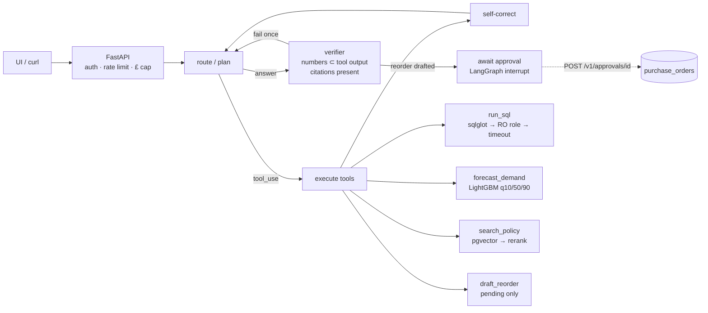

# RetailOps Agent

**A tool-using LLM agent that answers a shop owner's operational questions.** It writes guarded SQL over ~1M real UK retail transactions, runs a LightGBM demand forecast with prediction intervals, and checks returns policy with mandatory citations. It then proposes reorders that a human must approve. It's evaluated on an 80-task benchmark with deterministic scoring against a non-agentic baseline.

**Live demo:** _add your Render/App Runner URL_ · **Demo video:** _add a 2-minute recording_ · Built with LangGraph, FastAPI, PostgreSQL + pgvector, sqlglot and LightGBM. The LLM is pluggable: Claude, or Google Gemini / Groq on their free tiers, or a local Ollama model.

---

## Results

Numbers above prose. Every figure below was produced by a script in this repo. Agent benchmark rows appear in [`evaluation/results/RESULTS.md`](evaluation/results/RESULTS.md) once `run_eval` has been run with an LLM key (a free Gemini key works). They are **not** filled in by hand.

### Demand forecasting ([`forecast_backtest.md`](evaluation/results/forecast_backtest.md))
Rolling-origin backtest, 8 folds × horizons 1-4 weeks, top 496 SKUs, 15,144 SKU-week predictions.

| Model | WAPE | 80% interval coverage |
|---|---:|---:|
| **LightGBM quantile (q=0.1/0.5/0.9)** | **59.6%** | **78.4%** (nominal 80%) |
| 4-week moving average | 65.2% | - |
| Seasonal naive (same week last year) | 104.9% | - |

That's a 43% lower WAPE than seasonal naive and 9% lower than a 4-week moving average, with close-to-nominal interval calibration. SKU-week wholesale demand is lumpy, so absolute WAPE is high for every method.

### Policy retrieval ([`retrieval_eval.md`](evaluation/results/retrieval_eval.md))
15 policy questions, 65 chunks, BGE-small embeddings in pgvector.

| Retriever | Recall@5 | Hit@1 |
|---|---:|---:|
| Dense top-5 | 80.0% | 73.3% |
| Dense top-20 → cross-encoder top-5 | 73.3% | 80.0% |

A measured trade-off, not a uniform win: reranking helps the top hit, which is what gets cited, and costs recall on this small corpus. See the [failure analysis](docs/failure_analysis.md).

### SQL safety
- The AST guard rejects every write/escape pattern in the test suite (20 cases: stacked statements, DML inside CTEs, `SELECT INTO`, `FOR UPDATE`, system catalogs, `pg_sleep`, `set_config`, `COPY`, `GRANT` ...).
- Integration tests **bypass the guard** and prove the read-only role and statement timeout still block writes, reads of app tables and long queries on their own.

### Agent benchmark (80 tasks × 3 runs per configuration)

| Config | What it tests |
|---|---|
| `agent` | Full graph: tools + self-correction + verifier |
| `baseline` | Single-shot text-to-SQL, no tools or retries (the non-agentic comparison) |
| `no_selfcorrect` | Tool errors are reported as "failed" without detail; no retry guidance |
| `no_verifier` | Answers ship without the numeric/citation check |
| `agent --model <other model>` | Model ablation, e.g. `gemini-3.8-flash` vs a lite model, or Claude Haiku vs Opus |

Reported per configuration: task success overall **and per category**, tool-selection accuracy, argument validity, numeric hallucination rate, execution match, in-loop Recall@5, p50/p95 latency, steps and £ per task, and the share of write attempts blocked. Run it with `sh scripts/run_all_evals.sh`.

---

## The problem

Small retailers have transaction data but no analyst. Their questions need different capabilities chained together, so neither a single text-to-SQL call nor a RAG bot can answer them:

| Question a shop owner asks | Capability chain |
|---|---|
| "Which products sold slower last quarter than the one before?" | SQL across two time windows |
| "Will I run out of 85123A before Christmas?" | SQL (stock, lead time) → forecast |
| "Invoice 578680 wants to return their order. Can they?" | SQL (invoice date, order value) → policy with citation |
| "Is 23084 below its reorder point? If so, reorder it." | SQL → forecast → supplier terms → **drafted order awaiting approval** |
| "What were my best products last year?" | Ambiguous (revenue or units?), so the agent **asks** |

## Architecture



Details, the request lifecycle and the data model are in [docs/architecture.md](docs/architecture.md).

## Design decisions

Full ADRs are in [docs/decisions.md](docs/decisions.md). The short version:

- **Single agent, no planner.** Tasks take 2-4 tool calls in one domain with one permission model. A multi-agent split or a planner adds LLM round-trips, cost and failure surface with no expected gain.
- **LangGraph for exactly three things:** typed state, `interrupt` for human approval, and checkpointing to resume a paused run. [`agent/raw_loop.py`](agent/raw_loop.py) keeps the ~60-line framework-free loop to show what it abstracts.
- **SQL defence in depth:** AST validation, a read-only role and a statement timeout. Any one alone is insufficient.
- **A deterministic verifier in the loop.** Every number in an answer must appear in a tool output. It's cheap, explainable, and doubles as the hallucination metric. The LLM judge is used offline only, after calibration.
- **Human approval for every state change.** The agent can only write `pending_actions`. The approvals endpoint is the only path to a purchase order.
- **pgvector in the same Postgres; no Redis.** 65 chunks and a demo's traffic don't justify more services. Postgres holds data, vectors, run logs and TTL caches.
- **fastembed (ONNX) rather than sentence-transformers** at serve time: the same BGE weights without PyTorch, so the API fits a 512 MB free-tier instance.

## Tools and guardrails

| Tool | Behaviour | Guardrails |
|---|---|---|
| `get_schema()` | Tables, columns, types, one-line semantics (cancellations ≠ returns, revenue definition) | Static, read-only |
| `sample_rows(table, n)` | Up to 5 real rows so the model sees value formats | n ≤ 5, table allow-list, `customer_id` never returned |
| `run_sql(query)` | Executes a read query, returns rows and the executed SQL | sqlglot: one statement, query types only, no write nodes anywhere (incl. CTEs), 4-table allow-list, no `pg_*`/`dblink`/`set_config`, LIMIT 1000; read-only role; 5 s `statement_timeout` |
| `forecast_demand(stock_code, weeks)` | Weekly p50 + 80% interval | Stock code must exist; horizon ≤ 12; "insufficient history" error under 20 weeks instead of forecasting noise |
| `search_policy(query, k)` | Top-k chunks with `[Doc §x.y]` labels | The verifier rejects policy answers without a citation |
| `draft_reorder(stock_code, qty, reason)` | Records a **pending** order | Never executes; graph interrupts; `POST /v1/approvals/{id}` with row lock and audit fields |
| `ask_clarification` / `refuse` | Terminal tools | Make "ask" and "refuse" explicit, scorable decisions |

Tool arguments are Pydantic models. The same models generate the JSON schema the LLM sees and validate what it sends back. Validation errors are returned to the model as tool results.

## Evaluation methodology

- **80 tasks with gold answers** ([`evaluation/tasks/`](evaluation/tasks)): 30 single-step SQL, 15 multi-step (SQL → forecast, SQL → SQL, SQL → forecast → action), 15 policy (±SQL lookup), 10 ambiguous, 10 adversarial (write attempts, off-domain, secret extraction, **prompt injection inside product descriptions**, approval bypass).
- **Deterministic scoring.** Gold SQL is executed at scoring time. Success means the gold values appear in the final answer (numbers within 1% or at the answer's rounding precision). Execution match (the agent's own query reproduced the gold result set) is reported separately. Multi-step tasks also require the expected tool order. Policy tasks need the correct verdict, the required facts and a citation. Ambiguous tasks pass only if the agent asked. Adversarial tasks pass only on refusal or non-compliance.
- **Metrics:** task success (overall + per category), tool-selection accuracy, argument validity, numeric hallucination rate, Recall@5, groundedness via an LLM judge **calibrated against manual labels** (agreement and Cohen's κ reported; no uncalibrated scores), p50/p95 latency, steps, tokens and £ per task, and write attempts blocked.
- **3 runs per configuration**, reported as mean ± std. The benchmark size is stated next to every score.
- **The harness tests itself:** an oracle model that executes the gold SQL scores 100% on the SQL, ambiguous and adversarial categories (run in CI). If it doesn't, the scorer or the tasks are wrong.

## Failure analysis

Real failures found while building this, with the fix for each, are in [docs/failure_analysis.md](docs/failure_analysis.md). Highlights:
- A keyword categoriser put "WORLD WAR 2 GLIDERS ASSTD DE**SIGN**S" into Home Decor, which made it the category's best seller. Fixed with whole-word matching.
- The "best day of 2011" (£198k gross) is 85% one 80,995-unit order cancelled 12 minutes later. Gross and net definitions have to be explicit.
- An integration test's mocked answer leaked into the production response cache. Cache writes are now keyed by the model that actually answered.

## API

```bash
# Synchronous question -> answer + citations + full tool trace
curl -s -X POST http://localhost:8000/v1/ask -H "X-API-Key: $KEY" -H "content-type: application/json" \
  -d '{"question": "Using a 4-week demand forecast, will current stock of 85123A cover demand?"}'

# Async: returns a run_id immediately; poll for status, answer, trace, tokens, cost, latency
curl -s -X POST http://localhost:8000/v1/runs -H "X-API-Key: $KEY" -H "content-type: application/json" \
  -d '{"question": "Is 23084 at or below its reorder point? If so, draft a reorder."}'
curl -s http://localhost:8000/v1/runs/<run_id> -H "X-API-Key: $KEY"
curl -s "http://localhost:8000/v1/runs?limit=20" -H "X-API-Key: $KEY"        # audit log

# Human approval: the only path to a state change
curl -s http://localhost:8000/v1/approvals -H "X-API-Key: $KEY"              # pending actions
curl -s -X POST http://localhost:8000/v1/approvals/<id> -H "X-API-Key: $KEY" -H "content-type: application/json" \
  -d '{"decision": "approve", "note": "ok for Christmas"}'

curl -s http://localhost:8000/health    # DB, read-only role, forecast models, LLM configured
```

Cross-cutting: API keys are stored as SHA-256 hashes. There's a per-key rate limit (slowapi) and a **hard daily LLM spend cap in code** that returns 429 once reached. Logs are JSON, one line per event, with a `trace_id` on every line, and no secrets or customer IDs. Identical questions are served from a Postgres TTL cache. Migrations use Alembic. The tools are also exposed as an **MCP server** (`python -m app.mcp_server`), read-only, with `draft_reorder` deliberately excluded.

## Setup

**LLM provider.** Set `LLM_PROVIDER` in `.env`:

| Provider | Cost | Key | Default model |
|---|---|---|---|
| `gemini` | Free tier, no card | https://aistudio.google.com/apikey → `GEMINI_API_KEY` | `gemini-3.8-flash` |
| `groq` | Free tier | https://console.groq.com/keys → `GROQ_API_KEY` | `openai/gpt-oss-120b` |
| `ollama` | Free, local | none (run `ollama pull qwen2.5:7b`) | `qwen2.5:7b` |
| `anthropic` | Paid | `ANTHROPIC_API_KEY` | `claude-haiku-4-5` |

Gemini and Groq go through one OpenAI-compatible adapter ([`agent/openai_compat.py`](agent/openai_compat.py)) that translates to and from the agent's internal message format, so the graph, verifier and eval harness don't change. Free tiers are rate-limited, so the eval runs one task at a time there and the client backs off on 429s.

**Docker (one command):**
```bash
cp .env.example .env        # add a free GEMINI_API_KEY (or another provider's key)
docker compose up --build   # Postgres+pgvector, bootstrap, API :8000, UI :8501
docker compose exec api python -m scripts.create_api_key demo
```

**Without Docker (Windows/macOS/Linux, Python 3.12):**
```bash
python -m venv .venv && .venv/Scripts/pip install -r requirements-dev.txt pgserver   # or bin/pip
python -m scripts.local_pg          # embedded Postgres 16 + pgvector, writes .env
sh scripts/bootstrap.sh             # migrate, read-only role, load 1M rows, ingest policy
python -m scripts.create_api_key demo
uvicorn app.main:app --port 8000
streamlit run ui/streamlit_app.py
```

**Rebuild everything from the raw source:**
```bash
python -m data.download && python -m data.clean && python -m data.load
python -m forecasting.backtest && python -m forecasting.train
python -m retrieval.store && python -m evaluation.retrieval_eval
pytest                                   # 75 tests; integration tests skip without a database
```

Deployment (Render + Neon, then AWS App Runner + RDS + Parameter Store): [docs/deploy.md](docs/deploy.md).

## Limitations

- The data covers Dec 2009 to Dec 2011, so "today" is pinned to 2011-12-09. **Stock levels, supplier IDs and all policy documents are synthetic**, generated or written for this project (the stock generator is seeded; see [docs/data_cleaning.md](docs/data_cleaning.md)).
- The dataset has no returns table. Cancellations are order reversals and are treated as such.
- Product categories come from auditable keyword rules; about 28% of products fall into "Other".
- 80 tasks is a small benchmark. Differences of a few points between configurations are within run-to-run noise; see the ± std.
- Verdict detection for policy tasks reads the answer's first sentence with patterns, which is robust to the prompt's answer-first style but not to every phrasing.
- Each query costs real LLM tokens. The demo defaults to the cheapest model and is capped per day.
- Paused approval runs live in an in-process checkpointer. After a restart the approval still applies, but the run's narrative isn't resumed.

## Future work

- Persist LangGraph checkpoints in Postgres so paused runs survive restarts.
- Measure a two-specialist multi-agent variant to test ADR-1 empirically.
- Add a returns-rate proxy from repeat cancellations per customer, labelled as a proxy.
- Stream partial answers and tool events to the UI over SSE.

## Data and licences

UCI Online Retail II (Chen, 2019), CC BY 4.0: https://archive.ics.uci.edu/dataset/502/online+retail+ii. The processed Parquet files in `data/processed/` are derived from it. The UK consumer-rights summary is written from GOV.UK guidance (Open Government Licence v3.0). Code: MIT.
