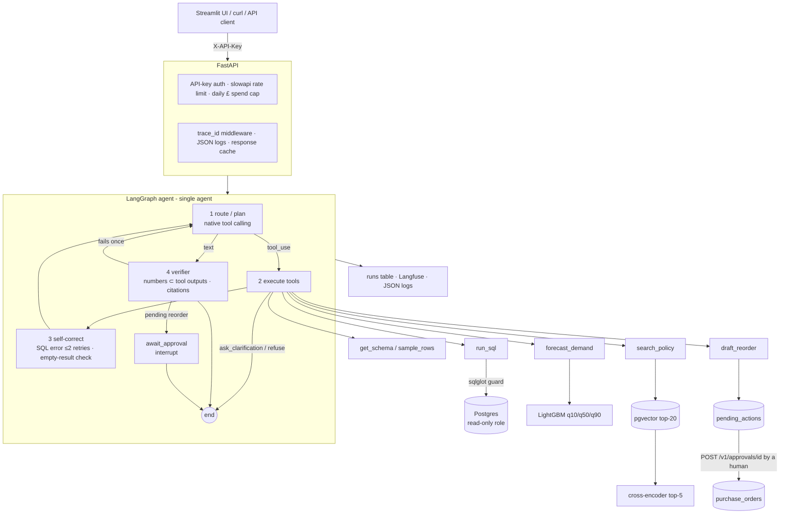

# Architecture

## Request lifecycle

1. `POST /v1/ask` → auth → rate limit → spend-cap check → response-cache lookup.
2. `run_agent` inserts a `runs` row (status `running`) so `draft_reorder` can reference it, then invokes the graph with `thread_id = run_id`.
3. **route** calls the model with the system prompt and 8 tool schemas (generated from Pydantic models). It records tokens, latency and cost per call. `step_limit` = 8.
4. **execute** runs every `tool_use` block of the turn concurrently and returns all `tool_result` blocks in one user message. Invalid arguments and tool errors come back as `is_error` results, never as exceptions.
5. **self_correct** appends targeted guidance to that message: the SQL retry count (max 2, then "stop and report"), the empty-result sanity check (once), and the timeout note.
6. **verify** checks numeric groundedness and citations. On failure it sends one regeneration request, then attaches a warning.
7. If a reorder was drafted, **await_approval** calls `interrupt`. The run returns `awaiting_approval`. `POST /v1/approvals/{id}` applies the decision in the database, then resumes the graph so the run records the outcome.
8. The run row is finalised (answer, trace, tokens, £ cost, latency). Traces are exported to Langfuse if configured.

## Data model

| Table | Purpose | Written by |
|---|---|---|
| transactions (1.02M rows), products, customers, stock_levels | Retail data | `data/load.py` only |
| policy_chunks (65) | Chunk text, section label, 384-d embedding (IVFFlat) | `retrieval/store.py` |
| runs | Audit log: question, answer, full trace, tokens, cost, latency, status | agent runner |
| pending_actions | Drafted reorders awaiting a human | `draft_reorder` |
| purchase_orders | Approved reorders, the only agent-caused state change | approvals endpoint |
| api_keys | SHA-256 hashes of API keys | `scripts/create_api_key.py` |
| response_cache, embedding_cache | TTL caches (Postgres instead of Redis) | API / retriever |

Indexes: `transactions(invoice_date)`, `transactions(stock_code)`, `transactions(customer_id)`, IVFFlat on `policy_chunks(embedding)`. Every agent query filters on date ranges or stock codes, so these two B-tree indexes let the planner avoid full scans on the 1M-row table for selective queries. Half-open date ranges (`>= start AND < end`) are required by the prompt partly so the index stays usable: `date_trunc(...) = ...` in a WHERE clause would defeat it.
