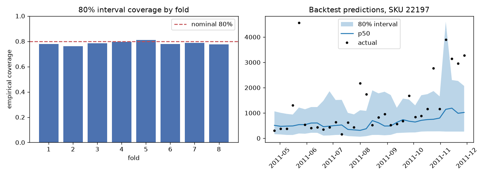

# Forecast backtest

Rolling origin, 8 folds x horizons 1-4 weeks, top 496 SKUs by volume, 15,144 SKU-week predictions. Generated by `python -m forecasting.backtest`.

| Metric | LightGBM quantile | Seasonal naive | 4-week moving average |
|---|---:|---:|---:|
| WAPE (all) | 59.6% | 104.9% | 65.2% |
| WAPE (where last-year value exists) | 59.5% | 108.7% | - |
| 80% interval coverage | 78.4% | - | - |

WAPE improvement over seasonal naive: **43.2%**. Seasonal naive falls back to the last observed week when a SKU has no sales history from 52 weeks earlier.

| Fold | Origin | WAPE model | WAPE s-naive | Coverage |
|---:|---|---:|---:|---:|
| 1 | 2011-04-18 | 60.7% | 113.1% | 77.8% |
| 2 | 2011-05-16 | 66.8% | 104.5% | 76.0% |
| 3 | 2011-06-13 | 63.2% | 111.9% | 78.4% |
| 4 | 2011-07-11 | 60.2% | 115.9% | 79.6% |
| 5 | 2011-08-08 | 59.4% | 102.7% | 81.2% |
| 6 | 2011-09-05 | 59.8% | 113.6% | 77.9% |
| 7 | 2011-10-03 | 59.4% | 107.5% | 78.8% |
| 8 | 2011-10-31 | 53.8% | 83.9% | 77.6% |

Coverage by horizon: h=1: 79.8%, h=2: 78.3%, h=3: 79.0%, h=4: 76.6%

